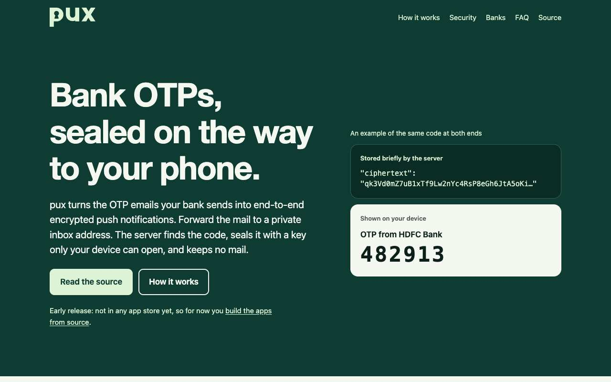
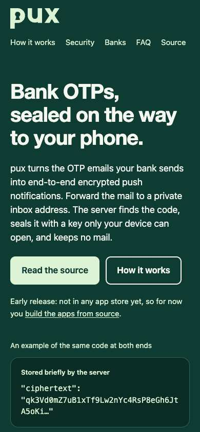

<h1>
  <picture>
    <source media="(prefers-color-scheme: dark)" srcset="brand/pux-wordmark-dark.svg">
    
  </picture>
</h1>

[](https://github.com/vidurb/pux/actions/workflows/server.yml)
[](https://github.com/vidurb/pux/actions/workflows/mobile.yml)
[](LICENSE)

Privacy-first OTP relay: receive bank OTP emails, parse the code in memory, end-to-end encrypt it, and push it to your devices.

Use the hosted instance at [pux.vidur.xyz](https://pux.vidur.xyz) or [run your own](deploy/README.md).

 

## Architecture

- **server/** — Phoenix/Elixir service (inbound SMTP, website, FCM push)
- **mobile/** — Flutter app (Android, iOS, macOS, Linux; Windows is not supported for now)
- **brand/** — logo, palette and icon sources ([guide](brand/README.md))

## Security model

- Encryption keypairs are generated on the mobile device; the private key never leaves the phone.
- The server stores only the client-supplied public key and encrypts OTP payloads with libsodium sealed boxes.
- Emails are parsed in memory and never stored.
- No accounts: a record ID is the only credential.
- New devices enroll in-app (`Create new relay` on mobile) or by scanning/importing a QR enrollment payload from an existing device. Desktop clients import enrollment JSON only (no key generation).
- Inbound SMTP validates recipient domains and caps message size.
- Push delivery is asynchronous (Oban) so SMTP responds immediately.

## Data retention

| What the server holds | Kept until |
|-----------------------|------------|
| Email contents | Never stored: in memory only, while parsing |
| Sealed envelope in a push job | About 10 minutes after the job finishes |
| Sealed envelope pending for a desktop | The desktop acknowledges it, or about 15 minutes |
| Phone: push token, platform, timestamps | You remove it, FCM reports the token dead, or 2 years with no registration and no accepted push |
| Desktop: generated ID, platform, timestamps | You remove it, or it hasn't registered for 90 days. A running app registers every 12 hours |
| Relay: record ID, inbox token, public key, timestamps | You delete it, or 30 days after it loses its last device |

OTPs can be months apart and the app may never be opened in between, so quietness says nothing about whether a phone still works. **The trade-off is that the server keeps a relay's inbox token, public key and push tokens for as long as the app stays installed**, whether or not any mail arrives, up to 2 years without the app being opened or a code being delivered, plus the relay's 30 days. Delete them at any time with **Delete relay everywhere**, or for the hosted instance by emailing your inbox address to the operator.

Keeping the registration doesn't guarantee delivery on the phone itself. **Android hibernates an app that hasn't been used for a few months**, and a hibernated app [can't receive pushes](https://developer.android.com/topic/performance/app-hibernation), even high-priority ones, until it is next opened. FCM still accepts those sends, so the server can't tell. Reading a notification doesn't count as use, though tapping one does. To rely on pux for rare codes, turn off **Pause app activity if unused** for it in Android's App info settings.

Mail to a relay with no devices is refused at `RCPT` with the same `550 5.1.1` an unknown address gets, so the sender's bounce shows that something is wrong without revealing which addresses exist. It takes effect as soon as a device registers again, and a refused message doesn't restart the 30 days. Some mail providers stop forwarding to an address that keeps bouncing, so after re-registering, check that your forwarding is still on. The mail that first discovers a dead token is still accepted and lost, because the push happens after the SMTP reply; later mail bounces. When the server removes a relay's device itself, the 30 days start at that moment, so an app that merely had its token replaced can come back. Removing the last device yourself starts no new period.

**After an uninstall** the app can't delete anything, and the server only learns about it from FCM:

- If mail still arrives, the next push gets FCM's answer: the device goes, and the relay follows 30 days later.
- If mail never arrives, a daily job asks FCM about tokens that have been quiet for 30 days, with a dry run that delivers nothing. FCM expires an Android device's token after 270 days without contact, so an Android relay should be gone within about 11 months at most, and sooner if FCM already knows of the uninstall.
- **iOS has no such expiry.** FCM relies on APNs there, and APNs reports a dead token in reply to a real push, which a dry run doesn't send. An uninstalled iOS app on a relay that never gets mail again stays until the 2-year limit, so about 2 years and a month in all, unless someone deletes the relay sooner.
- A server without `FCM_SERVICE_ACCOUNT_JSON` can't ask at all, so the same applies to any `fcm` device registered on it.

The cost of that limit: a phone that gets no code and never opens the app for 2 years is removed even if it still works. Opening the app once restarts the 2 years.

Dead tokens count towards `MAX_DEVICES_PER_RECORD` until they're found. If a new phone hits the cap and the relay's other devices are dead, send any OTP-shaped mail to the inbox address (`Your OTP is 123456`) to clear them, then tap **Retry**.

## Local development

### Server

```bash
cd server
mix deps.get
mix ecto.setup
mix phx.server
```

SMTP listens on port 2525 (`SMTP_PORT`) in every environment; map public port 25 to it. HTTP on 4000.

Tests need PostgreSQL (`DATABASE_URL`) and libsodium. The SMTP integration test talks to the real listener on port 2526 and the WebSocket tests to the endpoint on 4002 (override with `PUX_TEST_SMTP_PORT` / `PUX_TEST_HTTP_PORT`). See [CONTRIBUTING.md](CONTRIBUTING.md) for the full set of checks CI runs.

Toolchain versions are pinned in [`.tool-versions`](.tool-versions) (Elixir 1.18.4 / OTP 27.3.4).

### Mobile

```bash
cd mobile
flutter pub get
flutter run
```

Set `PUX_SERVER_URL` via `--dart-define=PUX_SERVER_URL=http://10.0.2.2:4000` for the Android emulator.

Platform targets:

| Platform | Delivery | Onboarding |
|----------|----------|------------|
| Android | FCM push | Create relay or QR scan |
| iOS | FCM push (APNs) | Create relay or QR scan |
| macOS / Linux | WebSocket + poll fallback | Import enrollment JSON only |
| Windows | — | Not supported for now (does not build in CI) |

Without Firebase config the app still runs, but the home screen says push is not configured. To enable FCM, run `flutterfire configure --project=<id> --out=lib/src/firebase_options.dart --platforms=android,ios` in `mobile/` (this writes `android/app/google-services.json`, `ios/Runner/GoogleService-Info.plist` and replaces the placeholder options), or pass `--dart-define=FIREBASE_*` values. These files are not secret and can be committed.

#### Testing on an Android phone

1. Configure Firebase as above and make sure the server has the matching `FCM_SERVICE_ACCOUNT_JSON`.
2. Build and install: `flutter build apk --debug --dart-define=PUX_SERVER_URL=https://pux.vidur.xyz`, then `adb install build/app/outputs/flutter-apk/app-debug.apk` (or `flutter run -d <device> --dart-define=...`). CI also uploads a debug APK as the `pux-android-debug-apk` artifact of the `mobile` workflow, but it is built without Firebase config, so it cannot receive pushes.
3. Open the app, tap **Create new relay**, allow notifications, and forward a test email (`Your OTP is 123456`) to the inbox address shown.

#### iOS push

iOS throttles data-only pushes and drops them for force-quit apps, so the server's FCM message also carries an `apns` alert: a generic "New code / Open pux to view" placeholder with `mutable-content: 1` (Android ignores it and stays data-only). The `NotificationService` app extension reads the keypair from a keychain group shared with the app (`$(AppIdentifierPrefix)xyz.vidur.pux.shared`, readable after first unlock), opens the sealed `ciphertext` and rewrites the title and body; if anything fails, the placeholder is shown. The app does not show its own copy of FCM messages on iOS. Before shipping:

1. Upload an APNs auth key to Firebase (Project settings → Cloud Messaging).
2. In the Apple Developer account, enable Push Notifications for `xyz.vidur.pux` and register `xyz.vidur.pux.NotificationService`. Set your team on both targets in Xcode (automatic signing creates the profiles; the keychain group needs no registration).
3. Debug builds use the APNs sandbox; Release and Profile use production (`Runner/RunnerRelease.entitlements`).

The extension target is added by `ruby ios/scripts/add_notification_service.rb` (needs the `xcodeproj` gem, which ships with CocoaPods); re-running it is safe. All iOS plugins are Swift packages, so the iOS build does not need CocoaPods.

To add a desktop, open the QR panel on the phone, tap **Copy enrollment JSON**, and paste it into the desktop app's **Import enrollment** screen. The JSON contains the private key.

Desktop clients register with `platform: "desktop"` and connect to `GET/DELETE /api/v1/record/deliveries` (oldest 50 pending per request) and `WS /ws/delivery` with the record ID in the `x-pux-token` header (the only accepted form; there is no query-param fallback).

### HTTP API

All under `/api/v1`. Every endpoint except `POST /records` works on the relay named by `Authorization: Bearer <record_id>`; the record ID, its only credential, is never in a URL. A missing or malformed token, or one that matches no record, gets 401 `{"error":"unauthorized"}`. These endpoints may also return 429 `{"error":"rate_limit_exceeded"}` (per record, `RECORD_API_RATE_LIMIT` per minute).

| Endpoint | Success | Notes |
|----------|---------|-------|
| `POST /records` | 201 `{"record_id","inbox_address","public_key"}` | Rate-limited per IP |
| `DELETE /record` | 204 | Deletes the record, its devices and pending deliveries; closes its delivery WebSockets |
| `POST /record/devices` | 201 `{"device_id","platform"}` | 422 `{"error":"too_many_devices"}` over `MAX_DEVICES_PER_RECORD`; re-registering a known token is always allowed |
| `DELETE /record/devices/:device_id` | 204 | 404 `{"error":"not_found"}` if the device is not on that record |
| `GET /record/deliveries` | 200 `{"deliveries":[{"delivery_id","envelope"}]}` | Oldest 50 |
| `DELETE /record/deliveries/:delivery_id` | 204 | 404 if unknown |

Each registration returns a `device_id`, which the app stores. The home screen menu offers **Remove this device** (`DELETE /api/v1/record/devices/:device_id`, then forget the keys locally) and **Delete relay everywhere** (`DELETE /api/v1/record`, which stops every device). If the server can't be reached the app offers to forget the relay locally anyway.

Imported or scanned enrollments must point at an `https` server (plain `http` only for `localhost`, `127.0.0.1` and `10.0.2.2`) and the app shows the server host for confirmation before saving.

Decrypted push payloads are JSON with a `type`:

- `otp`: `otp`, `sender`, `sender_domain`, `verified`, `received_at`, `parser`. `verified` is true when a valid DKIM signature aligns with the From domain; only then is `sender` a bank label, otherwise it is the From domain, and the app shows "OTP from <sender> (unverified)"
- `forward_confirm`: `code`, `url`, `sender`, `forwarding_from`, `received_at` (Gmail forwarding confirmation, only sent when its google.com DKIM signature verifies; confirm with the code or link to finish forwarding setup)

## Production environment variables

### Server

| Variable | Required | Description |
|----------|----------|-------------|
| `DATABASE_URL` | yes | PostgreSQL connection string |
| `SECRET_KEY_BASE` | yes | Phoenix secret |
| `LIVE_VIEW_SIGNING_SALT` | yes | LiveView WebSocket signing salt |
| `COOKIE_SIGNING_SALT` | yes | Session cookie signing salt |
| `PHX_HOST` | no | Public hostname (default `pux.vidur.xyz`) |
| `MAIL_DOMAIN` | no | SMTP recipient domain |
| `SMTP_PORT` | no | SMTP listen port (default `2525`; the image runs as non-root) |
| `SMTP_MAX_MESSAGE_SIZE` | no | Max inbound message bytes (default 1MB) |
| `SMTP_MAX_CONNECTIONS` | no | Max concurrent SMTP connections (default 100) |
| `SMTP_MAX_CONNECTIONS_PER_IP` | no | Max concurrent SMTP connections per client IP (default 5) |
| `SMTP_TLS_CERTFILE` / `SMTP_TLS_KEYFILE` | no | Enable inbound SMTP STARTTLS when both set (a warning is logged at boot when unset) |
| `MAX_DEVICES_PER_RECORD` | no | Device cap per record (default 10). Dead push tokens count until found; see [Data retention](#data-retention) |
| `RECORD_API_RATE_LIMIT` | no | Authenticated API requests per record per minute (default 120) |
| `SMTP_REQUIRE_TLS` | no | `true` to refuse `MAIL` before `STARTTLS` (`530 5.7.0`); only applies when STARTTLS is configured (default `false`) |
| `SMTP_INBOUND_RATE_LIMIT` / `SMTP_INBOUND_RATE_SCALE_MS` | no | Max OTP deliveries per record per window; extra mail is accepted and dropped (default 20 per `600000` ms) |
| `FCM_SERVICE_ACCOUNT_JSON` | no | Firebase service account JSON for push |

### Mobile release signing

Copy `mobile/android/key.properties.example` to `mobile/android/key.properties` and create a release keystore. Without `key.properties`, release builds fail with an error instead of falling back to the debug key; debug builds (`flutter build apk --debug`, used in CI) don't need it.

Android backups and device-to-device transfer are disabled for the app, so keys never leave the device that way. OTP notifications are hidden on a secure lock screen, and copied codes and enrollment JSON are marked sensitive and cleared from the clipboard after a minute if still there (not on iOS).

## Deployment

To run your own server with Docker Compose, see [deploy/README.md](deploy/README.md). Releases publish `ghcr.io/vidurb/pux-server:<version>`; `main` tracks the main branch.

The hosted instance runs on the homestacks Sinkhole cluster; see [`clusters/sinkhole/pux-system/README.md`](https://github.com/gpdl49/homestacks/blob/main/clusters/sinkhole/pux-system/README.md) for SMTP exposure, DNS, TLS and secrets.

## Contributing and security

See [CONTRIBUTING.md](CONTRIBUTING.md) for development setup and the release process, and [CHANGELOG.md](CHANGELOG.md) for what changed. Please report vulnerabilities privately as described in [SECURITY.md](SECURITY.md), not in public issues. Everyone taking part follows the [Code of Conduct](CODE_OF_CONDUCT.md).

## License

Copyright (C) 2026 vidurb

This program is free software: you can redistribute it and/or modify it under the terms of the GNU Affero General Public License as published by the Free Software Foundation, either version 3 of the License, or (at your option) any later version. It is distributed WITHOUT ANY WARRANTY; see [LICENSE](LICENSE) for the full text.

If you run a modified version of the server for others, the AGPL requires you to offer them its source.
